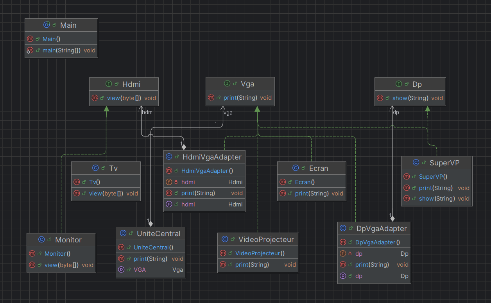
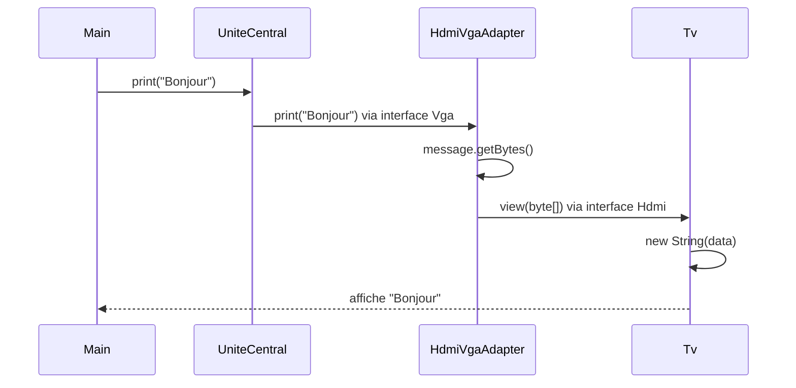
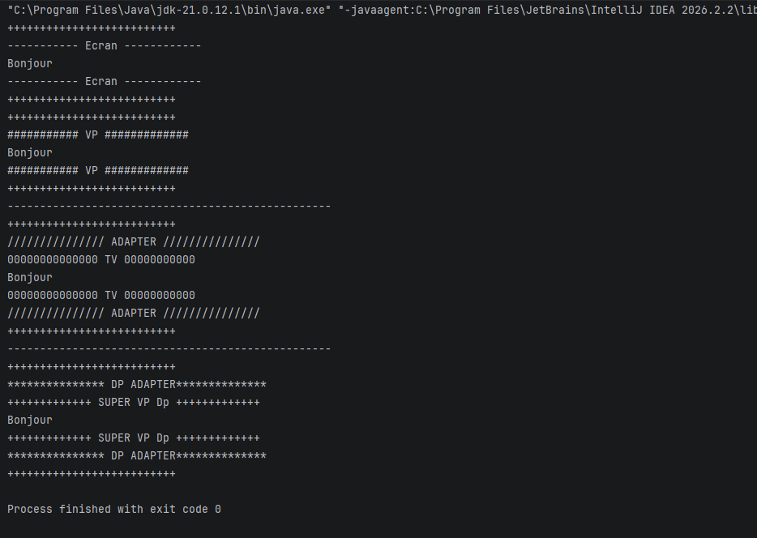

# Adapter-Design-Pattern

---

## Table des matières

1. [Présentation](#présentation)
2. [Le pattern Adapter](#le-pattern-adapter)
3. [Structure du projet](#structure-du-projet)
4. [Architecture et diagrammes](#architecture-et-diagrammes)
5. [Description des classes](#description-des-classes)
6. [Scénario de démonstration](#scénario-de-démonstration)
7. [Résultat attendu](#résultat-attendu)

---

## Présentation

Le projet met en scène trois « mondes » de périphériques d'affichage aux interfaces incompatibles :

| Interface | Méthode | Périphériques |
|---|---|---|
| `Vga` | `print(String message)` | `Ecran`, `VideoProjecteur`, `SuperVP` |
| `Hdmi` | `view(byte[] data)` | `Tv`, `Monitor` |
| `Dp` (DisplayPort) | `show(String message)` | `SuperVP` |

L'`UniteCentral` ne connaît que l'interface `Vga`. Pour lui faire afficher un message sur un appareil HDMI ou DisplayPort, on intercale un **adaptateur** qui implémente `Vga` côté unité centrale et appelle l'interface du périphérique de l'autre côté :

- `HdmiVgaAdapter` convertit la `String` en `byte[]` pour appeler `Hdmi.view` ;
- `DpVgaAdapter` transmet le message à `Dp.show`.

---

## Le pattern Adapter

L'**Adapter** est un pattern structurel. Il convertit l'interface d'une classe existante en une autre interface attendue par le client, ce qui permet à des classes **incompatibles** de collaborer **sans modifier leur code**.

Ce projet utilise la variante **Object Adapter** : l'adaptateur **contient** (composition) une instance de l'objet à adapter, au lieu d'en hériter.

---

## Structure du projet

```
Adapter-Design-Pattern/
├── pom.xml
├── .gitignore
└── src/
    └── main/
        └── java/
            └── com/
                └── zouhari/
                    ├── Main.java                     # Démonstration
                    └── computer/
                        ├── Vga.java                  # Interface cible (Target)
                        ├── Hdmi.java                 # Interface à adapter (Adaptee)
                        ├── Dp.java                   # Interface à adapter (Adaptee)
                        ├── UniteCentral.java         # Client
                        ├── Ecran.java                # Périphérique VGA
                        ├── VideoProjecteur.java      # Périphérique VGA
                        ├── SuperVP.java              # Périphérique VGA et DisplayPort
                        ├── Tv.java                   # Périphérique HDMI
                        ├── Monitor.java              # Périphérique HDMI
                        └── adapter/
                            ├── HdmiVgaAdapter.java   # Adaptateur Vga -> Hdmi
                            └── DpVgaAdapter.java     # Adaptateur Vga -> Dp
```

---

## Architecture et diagrammes

### Diagramme de classes



### Chaîne d'appel avec un adaptateur



---

## Description des classes

### Interfaces

| Interface | Rôle dans le pattern | Contrat |
|---|---|---|
| `Vga` | **Target** : interface attendue par le client | `void print(String message)` |
| `Hdmi` | **Adaptee** : interface incompatible à adapter | `void view(byte[] data)` |
| `Dp` | **Adaptee** : interface incompatible à adapter | `void show(String message)` |

### `UniteCentral` (client)

Détient une référence `Vga` et lui délègue l'affichage en l'encadrant de lignes de `+`.

- `setVGA(Vga)` : branche un périphérique (ou un adaptateur) ;
- `print(String)` : envoie le message au périphérique branché.

### Périphériques VGA (compatibles nativement)

| Classe | Cadre d'affichage |
|---|---|
| `Ecran` | `----------- Ecran ------------` |
| `VideoProjecteur` | `########### VP #############` |

### Périphérique double interface

| Classe | Interfaces | Cadre d'affichage |
|---|---|---|
| `SuperVP` | `Vga` et `Dp` | `+++++++++++++ SUPER VP Vga +++++++++++++` via `print`, `+++++++++++++ SUPER VP Dp +++++++++++++` via `show` |

Le cadre affiché indique par quelle interface le `SuperVP` a été appelé.

### Périphériques HDMI (incompatibles nativement)

| Classe | Cadre d'affichage |
|---|---|
| `Tv` | `00000000000000 TV 00000000000` |
| `Monitor` | `............... Monitor .............` |

Chacun reconstruit un `String` à partir du `byte[]` reçu (`new String(data)`).

### Adaptateurs (`adapter`)

| Classe | Rôle | Cadre d'affichage |
|---|---|---|
| `HdmiVgaAdapter` | Implémente `Vga`, convertit `String` en `byte[]` et appelle `Hdmi.view` | `/////////////// ADAPTER ///////////////` |
| `DpVgaAdapter` | Implémente `Vga` et appelle `Dp.show` avec le message tel quel | `*************** DP ADAPTER**************` |

Cœur de la conversion de `HdmiVgaAdapter` :

```java
@Override
public void print(String message) {
    byte[] data = message.getBytes();   // conversion String -> byte[]
    hdmi.view(data);                    // appel de l'interface adaptée
}
```

Cœur de `DpVgaAdapter` :

```java
@Override
public void print(String message) {
    dp.show(message);                   // appel de l'interface adaptée
}
```

L'objet adapté est injecté via `setHdmi(Hdmi)` ou `setDp(Dp)`.

---

## Scénario de démonstration

```java
UniteCentral uniteCentral = new UniteCentral();

// 1. Périphériques VGA : connexion directe
uniteCentral.setVGA(new Ecran());
uniteCentral.print("Bonjour");
uniteCentral.setVGA(new VideoProjecteur());
uniteCentral.print("Bonjour");

// 2. Téléviseur HDMI via HdmiVgaAdapter
HdmiVgaAdapter hdmiVgaAdapter = new HdmiVgaAdapter();
hdmiVgaAdapter.setHdmi(new Tv());
uniteCentral.setVGA(hdmiVgaAdapter);
uniteCentral.print("Bonjour");

// 3. SuperVP DisplayPort via DpVgaAdapter
DpVgaAdapter dpVgaAdapter = new DpVgaAdapter();
dpVgaAdapter.setDp(new SuperVP());
uniteCentral.setVGA(dpVgaAdapter);
uniteCentral.print("Bonjour");
```

---

## Résultat attendu



---

## Auteur

**ZOUHARI Dyae Errahmane** --- [GitHub](https://github.com/zouharidyaeerrahmane)    